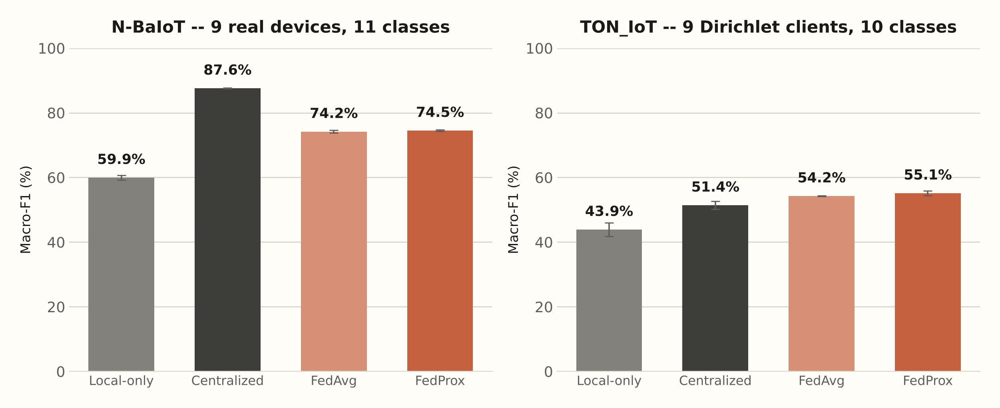
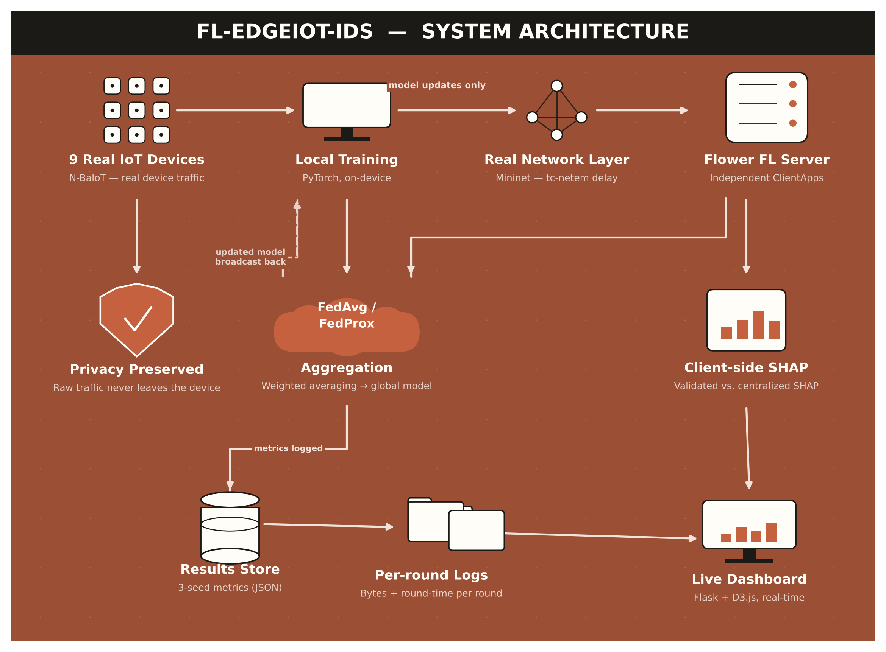
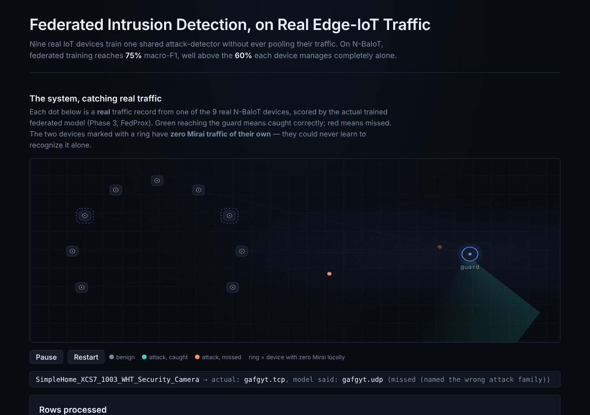

# FL-EdgeIoT-IDS

**A Privacy-Preserving Federated Learning Intrusion Detection System for Edge-IoT Networks**

Nine real IoT devices jointly train one shared attack-detector — without ever pooling their raw traffic.


> Computer Networks course project — Sparsh Y Bhagwat

---

## Table of Contents
- [Overview](#overview)
- [Key Results](#key-results)
- [System Architecture](#system-architecture)
- [Live Demo](#live-demo)
- [Repository Structure](#repository-structure)
- [Datasets](#datasets)
- [Tech Stack](#tech-stack)
- [Methodology](#methodology)
- [Getting Started](#getting-started)
- [Running the Live Demo](#running-the-live-demo)
- [Honest Limitations](#honest-limitations)
- [References](#references)

---

## Overview

IoT devices (cameras, doorbells, thermostats) are a growing target for botnets like **Mirai** and **Gafgyt**. The conventional fix — pooling every device's raw traffic on one central server to train a detector — costs privacy, bandwidth, and creates a single point of failure.

This project builds and **actually runs** a federated learning (FL) based Intrusion Detection System where **9 real IoT devices train one shared detector together, without any device ever sending its raw traffic anywhere.** Each device trains locally and shares only model weight updates; a coordinating server blends everyone's learning into one improved global model.

On top of the core FL pipeline, this project:
- Tests the model against an attack family **withheld entirely from every device during training** (true zero-day generalization, not just hand-waved).
- Makes every detection **explainable** via client-side SHAP, and **statistically validates** that the federated explanations agree with ground-truth centralized explanations.
- Deploys over a **real emulated network** (Mininet) and measures actual bandwidth/latency, instead of assuming savings.
- Reports every headline number as a **mean ± standard deviation over 3 random seeds** (42, 123, 2026).

Full writeup, literature review, and gap analysis: [`FL-EdgeIoT-IDS-Presentation.pptx`](./FL-EdgeIoT-IDS-Presentation.pptx) · [`PROGRESS.md`](./PROGRESS.md)

---

## Key Results

| Metric | Result |
|---|---|
| Federated (FedProx) vs. local-only macro-F1 — N-BaIoT | **74.5% vs. 59.9%** |
| Zero-day (truly unseen) Mirai catch rate — N-BaIoT | **85% ± 7%** (beats the centralized ceiling) |
| Client-side SHAP vs. centralized SHAP agreement | **Spearman ρ = 0.70 (N-BaIoT) / 0.90 (TON_IoT)**, both p < 1e-17 |
| Bandwidth: model update vs. raw traffic, real Mininet deployment | **7.3 MB vs. 1.2 GB** (~170× smaller) |
| float16-compressed model update | **0% accuracy lost**, 49% smaller payload |



*Federated training (FedAvg/FedProx) closes most of the gap between training alone (local-only) and the unrealistic, privacy-violating "pool everything" ceiling (centralized) — on both datasets, across 3 random seeds.*

---

## System Architecture



**Flow:** each of the 9 devices trains locally on its own traffic (PyTorch) → sends only its model update across a real Mininet-emulated network → the Flower FL server aggregates all 9 updates (FedAvg / FedProx) into one improved global model → the updated model is broadcast back for the next round. In parallel, each client computes its own SHAP explanation locally. Every round's metrics, bandwidth, and timing are logged and feed the live dashboard.

---

## Live Demo

A local Flask + D3.js web app visualizes real N-BaIoT traffic being scored live by the actual trained federated model.



- Each dot is a real recorded traffic row from one of the 9 real N-BaIoT devices.
- Scored live by the actual trained Phase 3 FedProx model.
- Teal = attack caught correctly, coral = attack misnamed (never let through as benign).
- Dashed ring = a device with zero Mirai traffic of its own — yet still protected, thanks to federated learning.
- Runs fully locally — no internet required.

See [Running the Live Demo](#running-the-live-demo) below to run it yourself.

---

## Repository Structure

```
fl-edge-ids/
├── src/
│   ├── data/            # Dataset loaders, stratified split, federated scaler (Phase 0)
│   ├── models/          # MLP and 1D-CNN-BiLSTM architectures
│   ├── train/           # Shared train/eval loop (plain PyTorch, no FL-specific code)
│   ├── baselines/       # Phase 1 (centralized) and Phase 2 (local-only) baselines
│   ├── federated/       # Phase 3/4 federated training (FedAvg/FedProx), zero-day setup
│   ├── xai/             # Phase 5 client-side SHAP + centralized ground-truth comparison
│   └── aggregate_3seed.py
├── webapp/
│   ├── app.py           # Flask server for the live demo
│   ├── data/            # Dashboard JSON data (generated from real results)
│   └── static/          # index.html, app.js (D3.js), vendored d3.min.js
├── results/             # All phase outputs: JSON metrics, model checkpoints (.pt), summaries
├── data/partitions/     # Preprocessed per-device parquet files (gitignored — see below)
├── docs/screenshots/    # README images
├── PROGRESS.md          # Full running build log — methodology, bugs found & fixed, decisions
├── FL_EdgeIoT_IDS_Implementation_Plan.md
├── FL-EdgeIoT-IDS-Presentation.pptx
├── run_3seed_batch.sh   # Driver script for the 3-seed statistical rigor pass
└── requirements.txt
```

---

## Datasets

| | N-BaIoT | TON_IoT |
|---|---|---|
| Source | 9 real IoT devices (doorbells, cameras, baby monitor, thermostat) | Realistic simulated network flow telemetry |
| Features | 115 packet-window features | 45 flow-level features |
| Classes | 11 (benign + Mirai & Gafgyt variants) | 10 (benign + multiple attack families, incl. ransomware) |
| Client split | **Natural** — 1 real device = 1 federated client | **Artificial** — Dirichlet partitioning (α ∈ {0.1, 0.5, 1.0}) across 9 clients |

**Raw datasets are not included in this repository** (N-BaIoT alone is ~4.7 GB). Download them yourself:
- N-BaIoT: [UCI Machine Learning Repository — detection_of_IoT_botnet_attacks_N_BaIoT](https://archive.ics.uci.edu/dataset/442/detection+of+iot+botnet+attacks+n+baiot)
- TON_IoT: [UNSW Canberra Cyber — TON_IoT Datasets](https://research.unsw.edu.au/projects/toniot-datasets)

Place them as described in `src/data/nbaiot.py` and `src/data/tonIoT.py`, then run the Phase 0 pipeline to produce the `data/partitions/` parquet files the rest of the pipeline reads.

---

## Tech Stack

| Layer | Tool |
|---|---|
| Model training | PyTorch (MLP baseline, 1D-CNN-BiLSTM) |
| Federated learning | Flower (`flwr`) — real independent client processes, FedAvg & FedProx |
| Explainability | SHAP |
| Real network emulation | Mininet (+ custom `delay_proxy.py`) |
| Metrics / partitioning | scikit-learn, imbalanced-learn (SMOTE ablation) |
| Live demo | Flask + D3.js |

---

## Methodology

Seven phases, each gating the next:

| Phase | Name | Purpose |
|---|---|---|
| 0 | Data pipeline | Clean, dedupe, stratified split, federated scaler |
| 1 | Centralized baseline | Upper bound — pools everything |
| 2 | Local-only baseline | Lower bound — each device trains alone, zero coordination |
| 3 | Federated training | FedAvg / FedProx across 9 real/Dirichlet clients |
| 4 | Zero-day test | Entire attack family withheld from **every** client |
| 5 | Explainability | Client-side SHAP, validated against centralized ground truth |
| 6 | Real network deployment | 9 real processes, real Mininet-injected delay |

All of Phases 1–4 are re-run across 3 seeds (42, 123, 2026) and aggregated by `src/aggregate_3seed.py`.

Full detail, including every bug found and fixed along the way, is in [`PROGRESS.md`](./PROGRESS.md).

---

## Getting Started

```bash
# clone your own repo (see below for how to push this one)
git clone <your-repo-url>
cd fl-edge-ids

# create a virtual environment
python -m venv .venv
.venv\Scripts\activate        # Windows
# source .venv/bin/activate   # macOS/Linux

# install dependencies
pip install -r requirements.txt
```

Download N-BaIoT and TON_IoT (see [Datasets](#datasets)) and run the Phase 0 pipeline before any other phase:

```bash
python src/data/pipeline.py        # or the equivalent Phase 0 driver you ran
python src/baselines/centralized.py   # Phase 1
python src/baselines/local_only.py    # Phase 2
python src/federated/run_phase3.py    # Phase 3
python src/federated/run_phase4.py    # Phase 4
python src/xai/shap_pipeline.py       # Phase 5
```

---

## Running the Live Demo

```bash
cd webapp
python app.py
```

Then open **http://localhost:5000** in your browser. The dashboard loads real results from `webapp/data/*.json` (generated from the actual Phase 1–5 outputs) and animates real N-BaIoT traffic rows being scored by the real trained model.

> **Windows tip:** if `python app.py` produces no output or seems to silently do nothing, Smart App Control may be blocking it. Run it with the full interpreter path instead, e.g.:
> `C:\Users\<you>\AppData\Local\Python\pythoncore-3.14-64\python.exe app.py`

---

## Honest Limitations

- **TON_IoT zero-day volatility** — the federated ransomware catch-rate swings from 24% to 98% across seeds; in-distribution accuracy stays stable, only unseen-class generalization is volatile.
- **Compute-bound test rig** — Phase 6's "round time stays flat under 5–50ms delay" result reflects a 2-CPU-core test machine, not a universal claim.
- **Phase 6 is single-run** — CPU contention from running 9 client processes + a server caused Flower's control-plane session token to expire after round 1 in every configuration tried; reported honestly as n=1 per configuration rather than fabricated multi-round curves.
- **Scope cuts** — differential privacy, defenses against a malicious/poisoning client, and 6G-scale extensions were explicitly out of scope for this pass (see Future Work in the presentation).

---

## References

1. Rey, V. et al. "Federated Learning for Malware Detection in IoT Devices." arXiv:2104.09994, 2021.
2. "A Lightweight Federated Learning Approach for Privacy-Preserving Botnet Detection in IoT." arXiv:2510.03513, 2025.
3. Chen, Y., Fang, F., Wang, B., Zhang, L. "An Efficient Federated Learning Framework for IoT Intrusion Detection" (FedKD-Prox). IEEE, 2024.
4. Izadi, et al. "Mist-Assisted Federated Learning for Intrusion Detection in Heterogeneous IoT Networks." arXiv:2511.00271, 2025.
5. Kalakoti, R., Bahsi, H., Nõmm, S. "Explainable Federated Learning for Botnet Detection in IoT Networks." IEEE CSR, 2024.
6. Abdelhady, G., Hussein, K.W., Gad, I.A.A. "FedShield-IDS." Scientific Reports, 2026.
7. "XAI FL-IDS: A Federated Learning and SHAP-Based Explainable Framework for Distributed Intrusion Detection Systems." arXiv:2605.19448, 2026.
8. Kalakoti, R. "Explainable Artificial Intelligence-Based Intrusion Detection Systems" (FedXAI). PhD thesis, TalTech, 2025.
9. "FLEET: A Federated Learning Emulation and Evaluation Testbed." arXiv:2509.00621, 2025.
10. Rezaei, H., Taheri, R., Nowroozi, E., Hajizadeh, M., Shiaeles, S., Bauschert, T. "A Survey on Security and Privacy in Federated Learning-Based Intrusion Detection Systems for 5G and Beyond Networks." IEEE OJCOMS, 2025.
11. Vyas, A., Lin, P.-C., Hwang, R.-H., Tripathi, M. "Privacy-Preserving Federated Learning for Intrusion Detection in IoT Environments: A Survey." IEEE Access, 2024.

---

*Computer Networks course project — built and validated against real device traffic, real network emulation, and real statistical rigor.*
